<h1 align="center">
  &nbsp;PeakDSA
</h1>

<p align="center">
  <em>Data structures and algorithms, explained with pictures, and real Python you can watch run one line at a time.</em>
</p>

<p align="center">
  
  
  
  
  
</p>

<p align="center">
  <a href="https://lyra-4leafclover.github.io/peak-dsa/"><b>Open the live site</b></a>
</p>

<p align="center">
  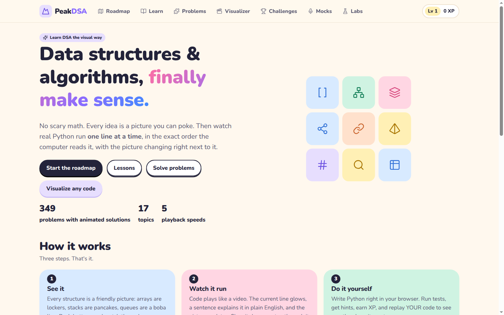
</p>

---

## What it is

PeakDSA is a website for learning data structures and algorithms (DSA) from zero, with nothing to install. Every idea comes with an everyday picture (arrays are lockers, stacks are pancakes), a toy you can click, and real Python code. The site runs that code and plays it back like a video: the current line lights up, a sentence says what it does in plain English, and the picture next to it changes.

It's made for complete beginners up to intermediate level and coding-interview prep.

<table>
  <tr>
    <td width="33%" valign="top"><b>Roadmap</b><br>One ordered path of 21 stages, from Python basics to advanced graphs and 2-D dynamic programming. Each stage has lessons, problems from easy to hard, and a checkpoint quiz.</td>
    <td width="33%" valign="top"><b>Learn</b><br>29 picture lessons. Each one has an analogy, the key moves and their cost, an interactive toy, a traced Python demo and common mistakes.</td>
    <td width="33%" valign="top"><b>Problems</b><br>349 of the most-asked interview problems, written in simple words, each with hints, a tested solution and its own step-by-step animation.</td>
  </tr>
  <tr>
    <td valign="top"><b>Visualizer</b><br>Paste any Python (a script, a function, or a LeetCode-style <code>class Solution</code>) and watch it run line by line.</td>
    <td valign="top"><b>Speed control</b><br>Snail, Walk, Run, Zoom and Manual speeds, a scrubber, arrow keys, and Predict mode, where you guess the next line before it runs.</td>
    <td valign="top"><b>Challenges, mocks, labs</b><br>Daily problem, predict-the-output, Big-O quiz, bug hunts, a speed round, timed mock interviews, and labs like a sorting race and a maze solver.</td>
  </tr>
  <tr>
    <td valign="top"><b>Write your own code</b><br>Every problem has an editor. Run the tests, then replay <i>your</i> code to see where it goes wrong.</td>
    <td valign="top"><b>Progress</b><br>XP, levels, streaks, badges and roadmap progress, saved in your own browser. No accounts.</td>
    <td valign="top"><b>Any screen</b><br>Works on phones, tablets, laptops and big monitors.</td>
  </tr>
</table>

## A look inside

<table>
  <tr>
    <td width="50%">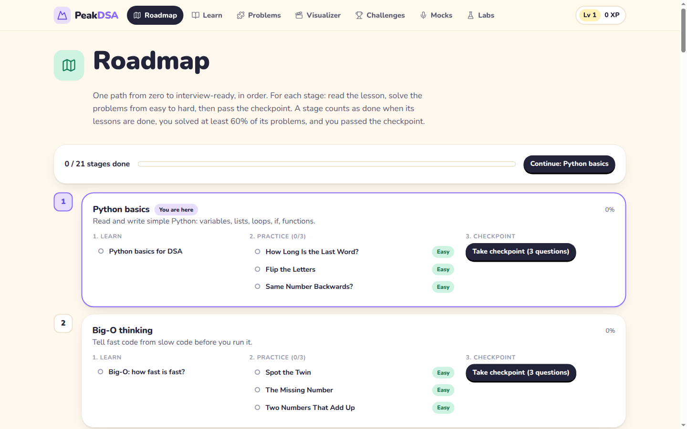<br><sub>The roadmap tells you what to do next.</sub></td>
    <td width="50%">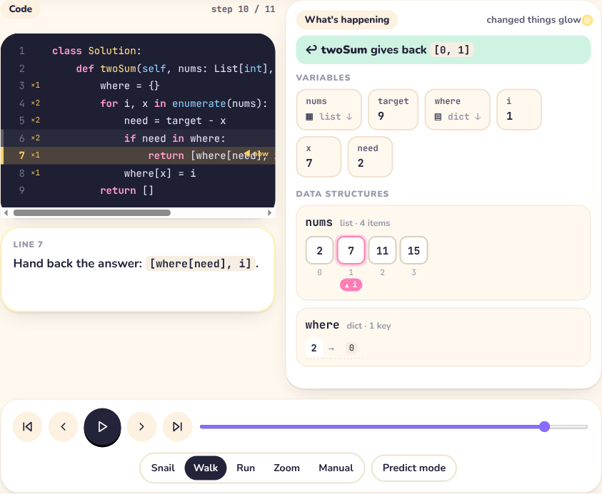<br><sub>A solution running line by line. Changed values glow.</sub></td>
  </tr>
  <tr>
    <td>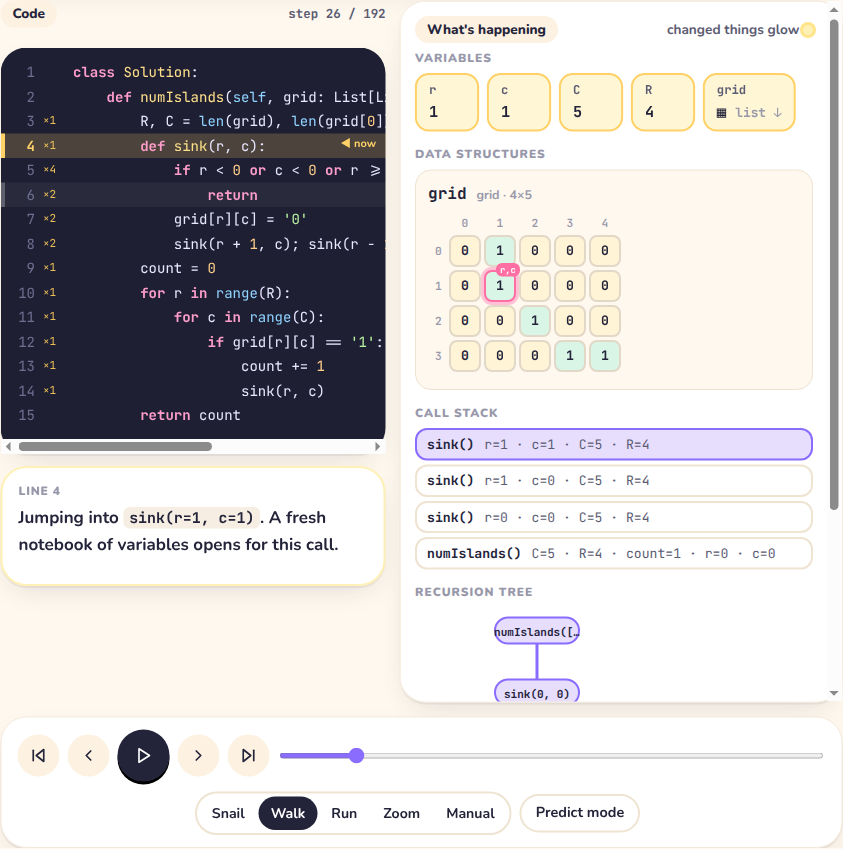<br><sub>Grids, trees, linked lists, graphs and the call stack are all drawn automatically.</sub></td>
    <td>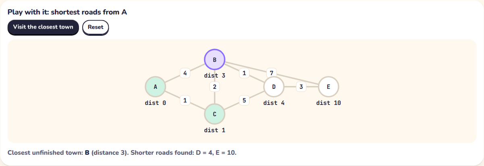<br><sub>Every lesson has a toy to poke at.</sub></td>
  </tr>
  <tr>
    <td>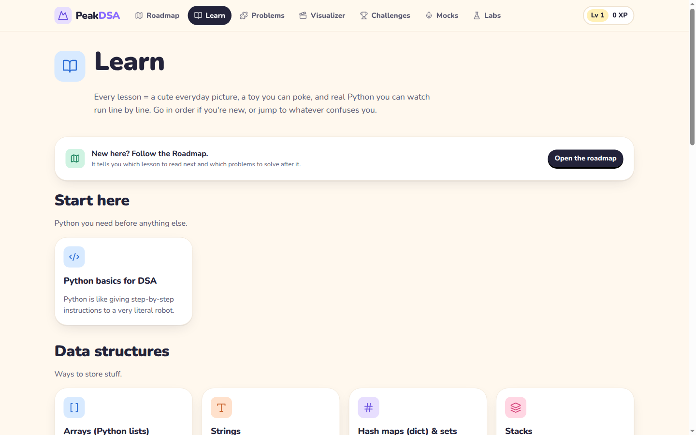<br><sub>29 lessons, starting with Python basics.</sub></td>
    <td>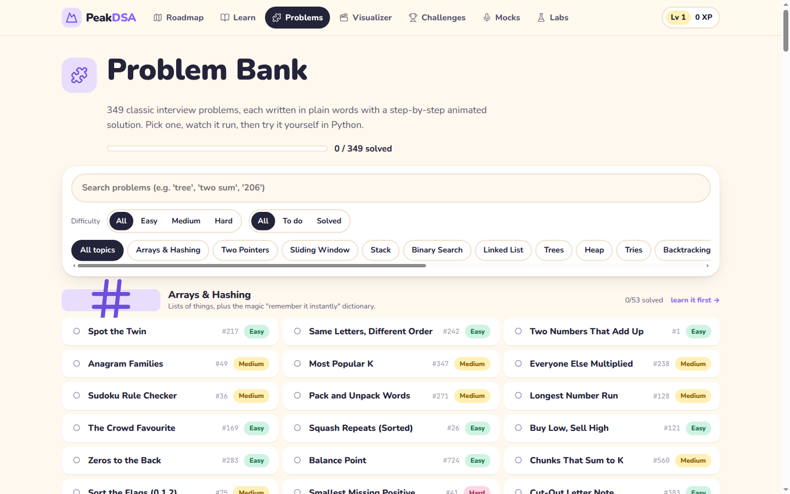<br><sub>349 problems across 17 topics.</sub></td>
  </tr>
  <tr>
    <td>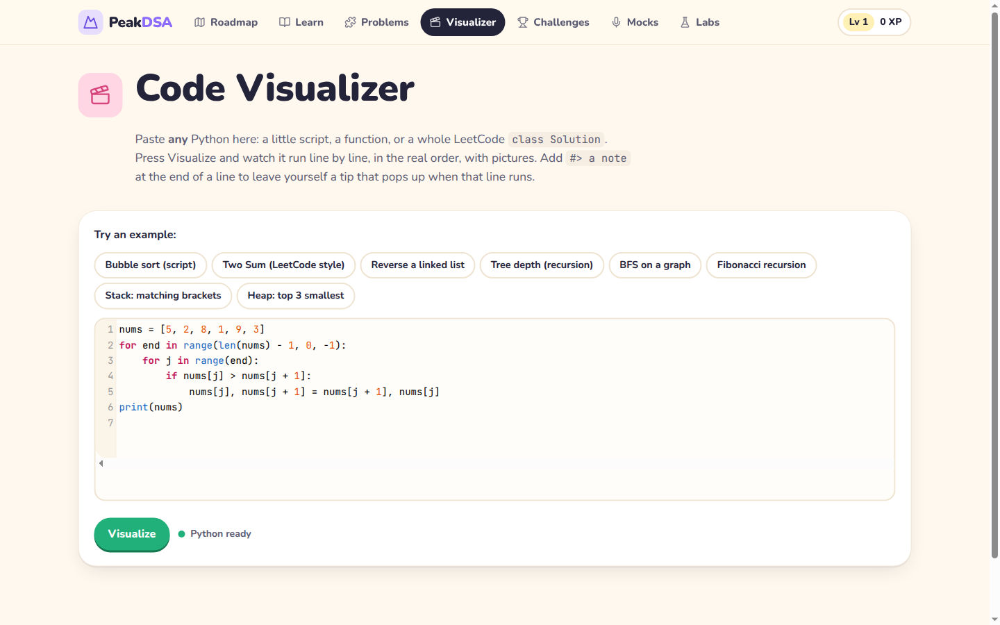<br><sub>Paste your own code into the Visualizer.</sub></td>
    <td>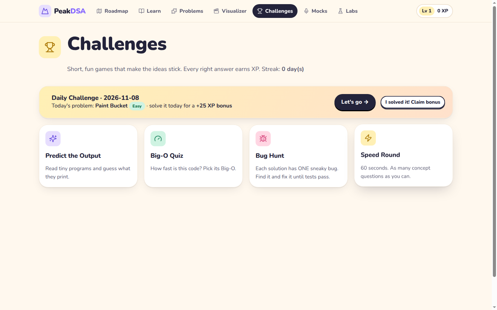<br><sub>Short games that make it stick.</sub></td>
  </tr>
  <tr>
    <td>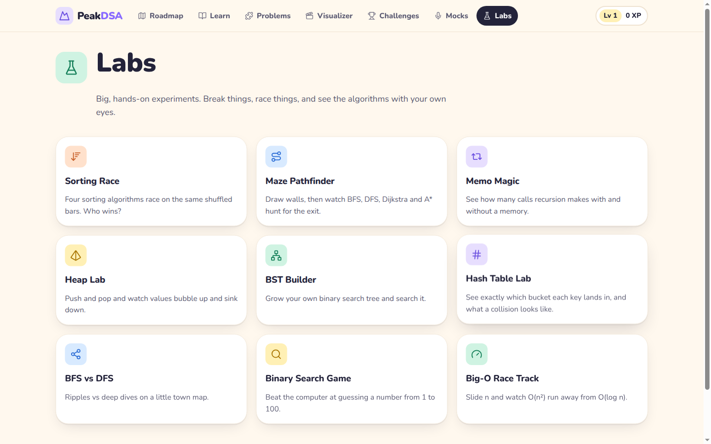<br><sub>Labs: sorting race, maze solver, heap and tree playgrounds.</sub></td>
    <td align="center">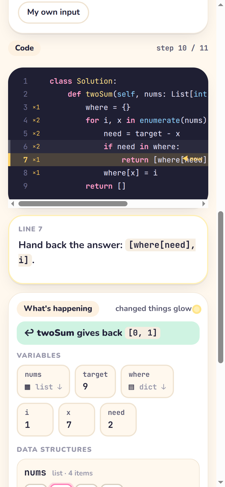<br><sub>On a phone.</sub></td>
  </tr>
</table>

## How to use it

1. Open the site and press **Start the roadmap**.
2. Do the stages in order. In each stage:
   - read the lesson and play with its toy, then press **I get it!**
   - solve the problems from top to bottom (they're sorted easy to hard). Stuck? Open a hint, or press play on the solution and watch it run.
   - take the 3-question checkpoint.
3. A stage is done once its lessons are done, you've solved at least 60% of its problems, and you've passed the checkpoint. The next stage is then marked **You are here**.
4. When you finish, try the **Mocks** page for timed practice interviews.

Watching code run:

| Control | What it does |
| --- | --- |
| Play / pause, or the space bar | Play the steps at the chosen speed |
| Back / Next, or the arrow keys | One step at a time |
| The slider | Jump to any step |
| Snail, Walk, Run, Zoom, Manual | Playback speed. Manual means you press Next yourself |
| Predict mode | The site pauses and asks which line runs next |

The first time you open a lesson or problem, Python takes about 5 to 10 seconds to load. After that it's quick.

## How it works

**In simple words:** the site doesn't play pre-made animations. When you press play, it really runs the Python code and writes down everything that happens: which line ran, and what every variable held at that moment. It then plays those notes back to you. So the pictures always show exactly what Python did.

**For developers:**

- **Python in the browser.** [Pyodide](https://pyodide.org) (CPython compiled to WebAssembly) runs inside a Web Worker (`js/engine/worker.js`), so the page never freezes.
- **Recording.** `js/engine/tracer.py` uses `sys.settrace` to record every line, call, return and exception. For each step it saves the local variables, the printed output, and a snapshot of every object reachable from them: lists, dicts, sets, deques, tuples, `ListNode`, `TreeNode`, graph nodes and tries. Runs stop after 3,000 steps so a mistake like an infinite loop can't hang the browser.
- **Playback.** `js/viz/player.js` replays the recorded steps instead of running the code again. `js/viz/render.js` picks a picture for each value: a row of boxes for a list, a grid for a list of lists, a tree or graph diagram for node objects, a stack of frames for recursion. `js/viz/explain.js` writes the plain-English sentence for each step.
- **Problems.** Each problem is written in `tools/problems/p*.py` with its story, hints, solution, tests and complexity. `python3 tools/build_problems.py` runs every solution against its tests in real CPython and only writes the problems that pass to `js/data/problems.js`. A solution line ending in `#> note` shows that note while the line runs.
- **Progress** is stored in `localStorage` under `peakdsa.v1`.

## The roadmap

| # | Stage | # | Stage |
| --- | --- | --- | --- |
| 1 | Python basics | 12 | Recursion & trees |
| 2 | Big-O thinking | 13 | Heaps |
| 3 | Arrays & strings | 14 | Backtracking |
| 4 | Hash maps & sets | 15 | Graphs & grids |
| 5 | Two pointers | 16 | Advanced graphs (union-find, topological sort, Dijkstra) |
| 6 | Sliding window | 17 | Tries |
| 7 | Prefix sums | 18 | Dynamic programming (1-D) |
| 8 | Stacks & monotonic stacks | 19 | Dynamic programming (2-D) |
| 9 | Binary search | 20 | Greedy |
| 10 | Sorting & intervals | 21 | Bit tricks |
| 11 | Linked lists | | Then: mock interviews |

## Run it yourself

It's a static site, so there's nothing to build or install.

```bash
git clone https://github.com/Lyra-4leafclover/peak-dsa.git
cd peak-dsa
python3 -m http.server 8000
# open http://localhost:8000
```

Double-clicking `index.html` won't work, because browsers block web workers and module imports on `file://` pages.

**Hosting:** upload the files as they are to GitHub Pages, Netlify, Vercel or Cloudflare Pages. The live site uses GitHub Pages from the `main` branch root (the `.nojekyll` file stops GitHub from processing the files).

## Adding problems

Add a `P(...)` entry to a file in `tools/problems/`, then run:

```bash
python3 tools/build_problems.py   # tests every solution, writes js/data/problems.js
```

## Files

| Path | What's there |
| --- | --- |
| `index.html` | The page shell and navigation |
| `css/` | `style.css` (colours, base styles, visualizations) and `pages.css` (page layouts, toys, roadmap) |
| `js/app.js` | Hash router: `#/roadmap`, `#/learn`, `#/problems`, `#/playground`, `#/challenges`, `#/mock`, `#/labs`, `#/me` |
| `js/engine/` | Pyodide worker and the `sys.settrace` tracer |
| `js/viz/` | Renderers, diffing, plain-English explanations and the step player |
| `js/pages/` | One module per page |
| `js/learn/` | The interactive toys for each lesson |
| `js/data/` | Lessons, roadmap stages, quizzes and the generated problem bank |
| `js/ui/icons.js` | Flat line icons used for page art |
| `tools/` | Problem sources and the build/validation script |
| `docs/` | Screenshots for this README |

## Credits

- Python runs on [Pyodide](https://pyodide.org) (MPL 2.0).
- Icons are from [Lucide](https://lucide.dev) (ISC).
- All problem descriptions are original, written for this project. LeetCode numbers are only given so you can find the matching problem.

<br>

<p align="center">
  <sub>made with care for every learner by Lyra</sub><br>
  <sub><a href="https://x.com/Lyra_void">X</a> · <a href="https://github.com/Lyra-4leafclover">GitHub</a> · <a href="https://lyradossier.vercel.app/">Portfolio</a></sub>
</p>
